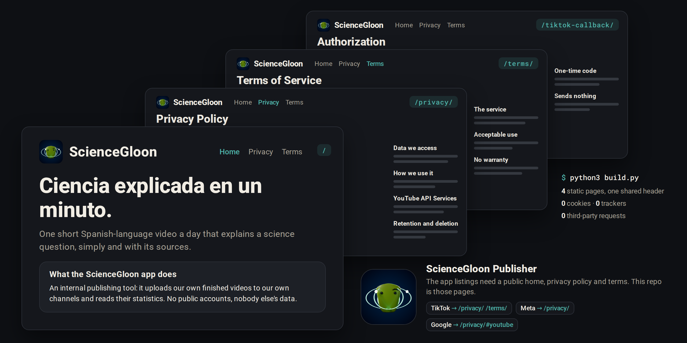
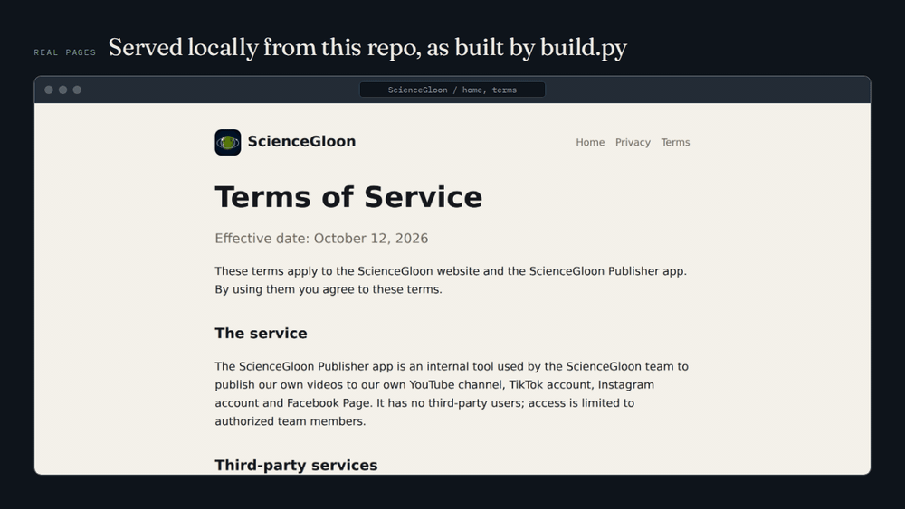
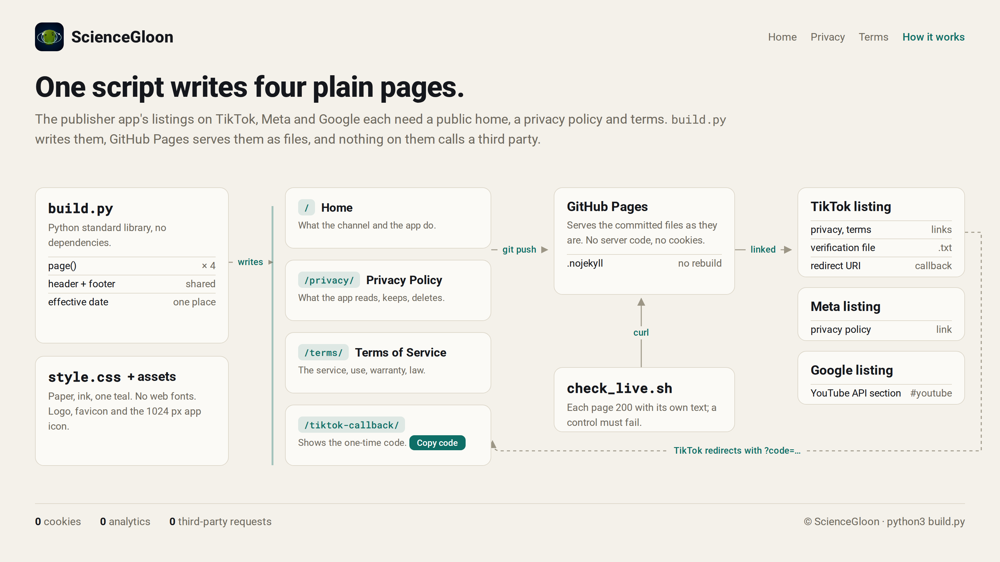

<p align="center"><a href="#demo"><picture>
  <source media="(prefers-color-scheme: light)" srcset="docs/images/banner-light.png">
  
</picture></a></p>

<p align="center"><b>Science explained in a minute. The public home and legal pages of the channel.</b><br>
<a href="#how-to-build">Install</a> · <a href="#demo">Demo</a> · <a href="#how-it-works">How it works</a> · <a href="build.py">Source</a></p>

<p align="center">
  
  
  
  
</p>

# sciencegloon-site

Public website of **ScienceGloon** (GitHub Pages): home, `/privacy/`, `/terms/`, `/tiktok-callback/`, app icon. Needed by
the TikTok, Meta and Google developer apps. Plain HTML from `build.py` (`python3 build.py`); no cookies, analytics,
trackers or third-party requests. The logo, favicon and app icon are the ScienceGloon kit from gloons-branding (renders/sciencegloon_*; gloons-branding#29).
artwork from gloons-branding (the canonical Gloon in a lab scene; no costume, owner 2026-10-12).

## How to build

```bash
python3 build.py                  # writes index.html, privacy/, terms/, tiktok-callback/
python3 -m http.server 8000       # preview at http://localhost:8000
```

## Demo

<p align="center"></p>

<sub>Real pages, served locally from this repo: the home page and the terms page.</sub>

## How it works

<p align="center"></p>

`build.py` writes the four pages with one shared header and footer. GitHub Pages serves them as plain files, and the
TikTok, Meta and Google app listings of the ScienceGloon Publisher app link to the privacy and terms pages. Nothing on
the pages calls a third party.
